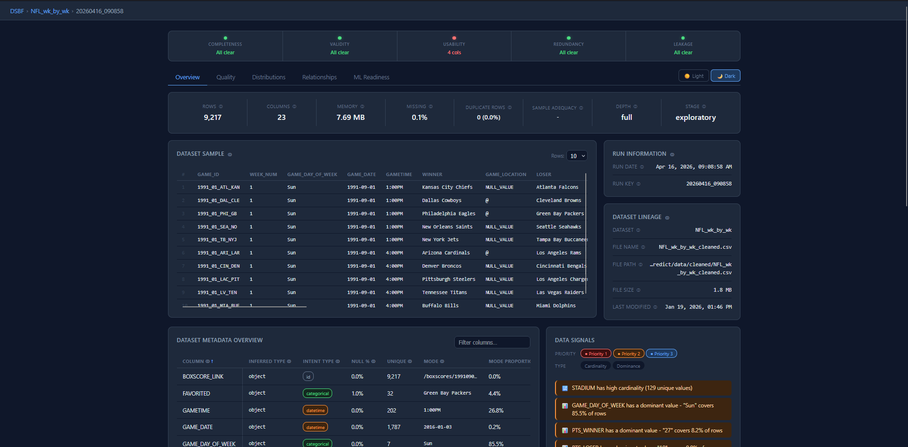

# DSBF — Data Scientist's Best Friend

[](https://www.python.org/)
[](LICENSE)
[](https://github.com/astral-sh/ruff)
[](https://pyrefly.org/)

**DSBF is a statistically grounded, workflow-aware profiling engine designed to be a reliable co-pilot at every phase of the data science process.**

The goal is simple: the exploratory and preparatory portions of data science work are largely reproducible. The same questions get asked of every new dataset — what's missing, what's skewed, what's redundant, what's suspicious — and they deserve a standardized, rigorous answer every time. DSBF provides that answer through a structured task engine, a five-dimension quality framework, and an interactive dashboard that turns raw data into actionable insight within minutes.

The first phase — **Exploratory Data Analysis** — is what DSBF does today. It gives any data scientist, regardless of experience level, an immediately reproducible structure for understanding a new dataset: consistent findings, plain-English guidance grounded in statistical theory, and a dashboard designed to accelerate insight rather than replace judgment. From there, a dataset can be understood on its own terms before any modeling assumptions are introduced.

The broader vision is a tool that grows with the workflow — covering data preparation, modeling, inference, and tradeoff analysis under the same statistically honest, reproducible framework. That work is ongoing.

---

## Standing on the shoulders of giants

Tools like [ydata-profiling](https://github.com/ydataai/ydata-profiling) and [Great Expectations](https://github.com/great-expectations/great-expectations) are genuinely excellent and were a direct inspiration for this project. ydata-profiling in particular demonstrated how much value a single well-designed profiling report could deliver to a data scientist's workflow.

DSBF takes a different set of design bets:

**On scoring:** most tools surface an aggregate quality score. DSBF deliberately does not — a single number creates false anchoring and masks the specific dimensions that actually matter. Five independently-scored dimensions (Completeness, Validity, Usability, Redundancy, Leakage) replace it, each with its own traffic-light indicator and findings.

**On language:** DSBF treats epistemic honesty as a design constraint. Where the evidence is ambiguous — missingness mechanism classification is a good example — DSBF uses hedged language ("consistent with MAR") and caps confidence deliberately. It will never claim to confirm what the data can only suggest.

**On workflow scope:** rather than producing a static report, DSBF is designed as a growing co-pilot. The EDA phase is what exists today. Modeling preparation, modeling, inference, and tradeoff analysis are the phases being built toward — all under the same statistically rigorous, reproducible framework.

---

## Dashboard



The Vue 3 SPA dashboard gives you:

- **Overview tab** — five traffic-light quality indicators (Completeness, Validity, Usability, Redundancy, Leakage) with a trust banner that updates as you profile
- **Distributions tab** — per-column analysis with outlier detection, normality assessment, skewness findings, and transformation previews
- **Relationships tab** — pairwise association table (Pearson r, Cramér's V, eta-squared, Kendall's τ), correlation heatmap, and fuzzy duplicate detection
- **Quality tab** — dimension-by-dimension findings with severity-ranked rows, expandable detail, and inline remediation guidance
- **ML Readiness tab** — five preparation-action dimensions (Transformations Needed, Encoding Required, Missingness Impact, Leakage Risk, Unusable Features) with a gate banner
- **Time Series tab** — ACF/PACF, stationarity tests, and seasonal decomposition

---

## Architecture

```
CSV / DataFrame
      │
      ▼
┌─────────────────────────────────────────────────────┐
│  Task Engine  (DAG-based, dependency-aware)         │
│  60+ tasks · topological execution · failure        │
│  recovery · profiling depth · stage inference       │
└────────────────────┬────────────────────────────────┘
                     │  TaskResult objects
                     ▼
              SQLite + JSON store
                     │
                     ▼
            FastAPI REST backend
                     │
                     ▼
            Vue 3 SPA dashboard
```

Every task is a self-contained Python class that declares its dependencies, expected semantic types, and runtime estimate. The DAG engine resolves execution order, handles failures without stopping the run, and writes structured `TaskResult` objects to a SQLite store. The FastAPI backend serves those results to the Vue dashboard over a clean REST API.

---

## Key design principles

**No single aggregate scores.** Both a numeric DQ score and column-level ML Readiness scores were designed and then scrapped — single numbers create false anchoring and ambiguous meaning across domains. Five independently-scored dimensions replaced them.

**Epistemic honesty as a first-class constraint.** Missingness mechanism analysis (MCAR / MAR / MNAR classification) deliberately caps confidence at "moderate" and uses `consistent_with` language throughout. DSBF will never claim to *confirm* MNAR — only to report evidence consistent with it.

**Severity-aware traffic lights.** A four-state system (🟢 green / 🔵 blue / 🟡 amber / 🔴 red) maps both *severity* and *proportion* to color. A single `warn`-level finding on a 500-column dataset is always amber — it never hides behind a green dot just because it affects 0.2% of columns.

**Semantic type filtering.** Tasks that operate on continuous columns filter by `analysis_intent_dtype`, not `pandas dtype`. A boolean stored as `int64` will not enter VIF computation or outlier detection.

---

## Installation

```bash
git clone https://github.com/W-Thurston/dsbf.git
cd dsbf
uv sync
```

**Requirements:** Python 3.12+ · [uv](https://docs.astral.sh/uv/) · Node.js 24 (only for the dashboard) · Graphviz (the `dot` executable, for the task-graph image)

---

## Quickstart

### CLI — profile a CSV

```bash
uv run dsbf profile data.csv
uv run dsbf profile data.csv --depth full --name my_data
```

`--depth` defaults to `standard` here (`basic | standard | full`), and `--name` sets the dataset name shown in the dashboard (the default is the file name without its extension).

### CLI — built-in datasets

```bash
uv run dsbf quickstart titanic     # seaborn built-in
uv run dsbf quickstart iris        # sklearn built-in
```

### Python API

```python
from dsbf.interfaces.api import EDA

results = EDA("data.csv").run()  # dict of task name -> TaskResult
```

### In-memory DataFrame

```python
import pandas as pd
from dsbf.interfaces.api import EDA

df = pd.read_csv("data.csv")  # a Polars DataFrame works too
results = EDA(df).run()
```

### Launch the dashboard

```bash
# Start the FastAPI backend
uv run uvicorn dsbf.api.main:app --reload

# In a separate terminal, start the Vue dev server
cd frontend && pnpm install && pnpm dev
```

---

## Profiling depth

Each depth includes the ones above it. Of the 67 registered tasks, 17 run at `basic`, 54 at `standard` and all of them at `full`.

| Depth | Adds | Best for |
|---|---|---|
| `basic` | Shape, nulls, types, duplicates, constant columns, value counts, data quality scoring | Quick triage, large datasets |
| `standard` | + missingness, distributions and normality, skewness, encoding and binning suggestions, group-difference tests, fuzzy duplicates, time series (when configured), ML readiness | Typical EDA workflow |
| `full` | + outliers, pairwise associations, mutual information, collinearity (VIF), data leakage, drift, schema validation | Pre-modeling audit |

`dsbf profile` runs at `standard` unless you pass `--depth`. The default config sets `full`, which `dsbf quickstart` and `dsbf run` use.

---|---|---|
| `basic` | Core shape, nulls, types | Quick triage, large datasets |
| `standard` | + distributions, outliers, associations | Typical EDA workflow |
| `full` | + ML readiness, time series, fuzzy duplicates | Pre-modeling audit |

---

## Output artifacts

Each run writes to a timestamped directory under `<home>/outputs/` and records the run in a SQLite database at `<home>/dsbf.db`, whatever the working directory. The home is `$DSBF_HOME` if set, otherwise the per-user data directory (`~/.local/share/dsbf` on Linux). `DSBF_DB_PATH` overrides the database location alone. Outputs and database paths are stored absolute.

| File | Description |
|---|---|
| `report.json` | All task results — findings, guidance, reliability warnings |
| `metadata_report.json` | Timing, system info, task diagnostics |
| `run.log` | Full execution log |
| `figs/` | Plots as PNG, plus Plotly figures as JSON |
| `figs/dag.png` | Task execution graph (when `metadata.visualize_dag` is on and Graphviz is installed) |

---|---|
| `report.json` | All task results — findings, guidance, reliability warnings |
| `metadata_report.json` | Timing, system info, task diagnostics |
| `run.log` | Full execution log |
| `figs/` | Static plots (PNG) and interactive SVG |
| `dag.png` | Task execution graph (if enabled) |

---

## Configuration

`src/dsbf/config/default_config.yaml` holds every option. A few of them, with their default values:

```yaml
metadata:
  profiling_depth: full         # basic | standard | full
  message_verbosity: debug      # quiet | warn | stage | info | debug
  visualize_dag: true

engine:
  backend: polars               # polars | pandas

safety:
  strict_mode: false            # true: halt on config or task-graph errors

tasks:
  detect_outliers:
    method: all                 # all | iqr | zscore | mad | isolation_forest
    flag_threshold: 0.01
  detect_collinear_features:
    vif_threshold: 10.0

time_series:
  enabled: false
  datetime_index_column: null   # must be set explicitly — DSBF will not guess
```

Pass a config of your own with `uv run dsbf run --config my_config.yaml`.

---

## Extending DSBF

Tasks are registered with a decorator. Save this as `custom_plugins/my_domain/numeric_columns.py`:

```python
from dsbf.core.base_task import BaseTask
from dsbf.eda.task_registry import register_task
from dsbf.eda.task_result import TaskResult


@register_task(
    display_name="Numeric Column Count",
    domain="my_domain",
    depends_on=["infer_types"],
    profiling_depth="standard",
    expected_semantic_types=["continuous"],
)
class NumericColumnCount(BaseTask):
    def run(self) -> None:
        matched_cols, _ = self.get_columns_by_intent()
        self.output = TaskResult(
            name=self.name,
            status="success",
            summary={"numeric_columns": len(matched_cols)},
            data={"columns": matched_cols},
        )
```

Then point the config at the directory (a path relative to the working directory) and include the task's domain, because the default config only runs tasks from the `core` domain:

```yaml
task_groups:
  - core
  - ./custom_plugins/my_domain/

task_selection:
  include_domains: [core, my_domain]
```

The built-in `core` group is loaded from `src/dsbf/custom_plugins/core`. `src/dsbf/custom_plugins/example_plugin_domain/` holds a minimal example.

---

## Validation suite

DSBF ships with a purpose-built validation suite covering eight dataset archetypes:

| Dataset | Purpose |
|---|---|
| `clean` | Baseline — all tasks succeed, no false positives |
| `tiny` | 25-row graceful degradation, low-N reliability warnings |
| `near_clean` | Calibration — mild issues detected correctly |
| `all_categorical` | Zero continuous columns — continuous tasks degrade cleanly |
| `high_missingness` | Structured MAR patterns, extreme null rates |
| `severe_multicollinearity` | Four VIF failure modes including scale-mismatch regression test |
| `single_column` | Pair-based tasks degrade gracefully with one column |
| `wide` | 100-column scale — column browser, heatmap, pairwise associations |

```bash
# Generate the datasets into tests/datasets/ (all of them, or --only near_clean ...)
uv run python tests/generators/dsbf_test_dataset_generator.py --only near_clean

# Profile one, then validate its report (pass the report path printed by the run)
uv run dsbf profile tests/datasets/near_clean.csv --name near_clean
uv run python tests/validation/run_validation.py --datasets near_clean \
    --skip-generate --report "$DSBF_HOME/outputs/<timestamp>/report.json"
```

Without `--report`, the script picks the most recently written report under `dsbf/outputs/` (a location DSBF no longer writes to), which may belong to a different dataset.

---

## Roadmap

The plan for what comes next, phase by phase, is in [`ROADMAP.md`](ROADMAP.md). The design behind it is in [`docs/REFACTOR_PLAN.md`](docs/REFACTOR_PLAN.md), and [`docs/architecture.md`](docs/architecture.md) describes how the code works today.

DSBF is designed to eventually cover the full data science workflow — EDA today, then modeling preparation, modeling, inference, and tradeoff analysis — all under the same statistically honest, reproducible framework. Each phase will follow the same principle: the reproducible parts of data science work should be standardized so practitioners can focus their judgment on the parts that actually require it.

---

## Contributing

Contributions are welcome. Please read [`CONTRIBUTING.md`](CONTRIBUTING.md) for conventions on task structure, commit style, and the review process.

```bash
# Run the fast gate (about 30 seconds), then the full suite (about 5 minutes, needs network)
uv run pytest -m "unit and not slow"
uv run pytest

# Lint and format
uv run ruff check .
uv run ruff format --check .
```

The validation suite is described above.

All contributions must include docstrings, pass Ruff linting (`max-line-length = 88`), and include or update relevant validation assertions.

---

## License

MIT — see [`LICENSE`](LICENSE) for details.
